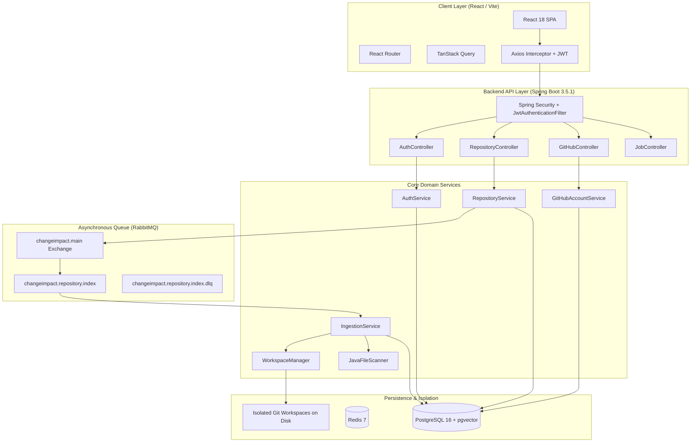

# ChangeImpact AI — System Architecture

## Security Architecture
1. **Stateless JWTs**: Access tokens expire in 15 minutes and carry HMAC-SHA256 signatures with minimal claims (userId, email, username).
2. **Refresh Token Rotation**: Refresh tokens expire in 7 days, stored strictly as SHA-256 hashes in PostgreSQL.
3. **AES-256-GCM Token Encryption**: Connected GitHub tokens are encrypted before saving and decrypted on-the-fly for JGit or WebClient operations.
4. **JGit Workspace Sandbox**: Operations are confined to isolated directory structures (`changeimpact/workspaces/<uuid>`). Path traversal and symlink escapes are actively checked and rejected.

