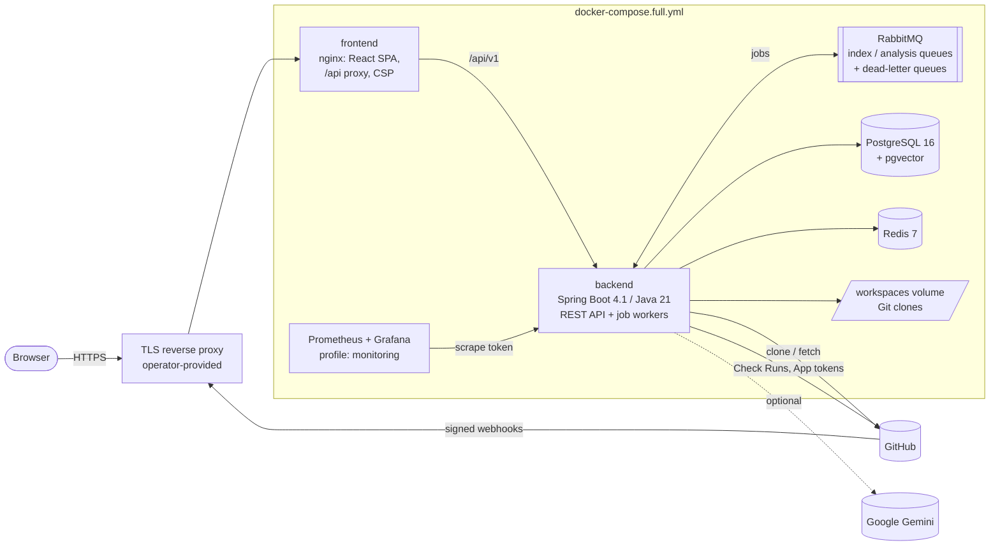
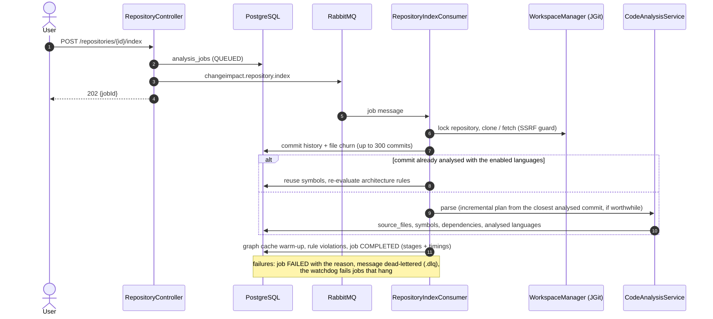
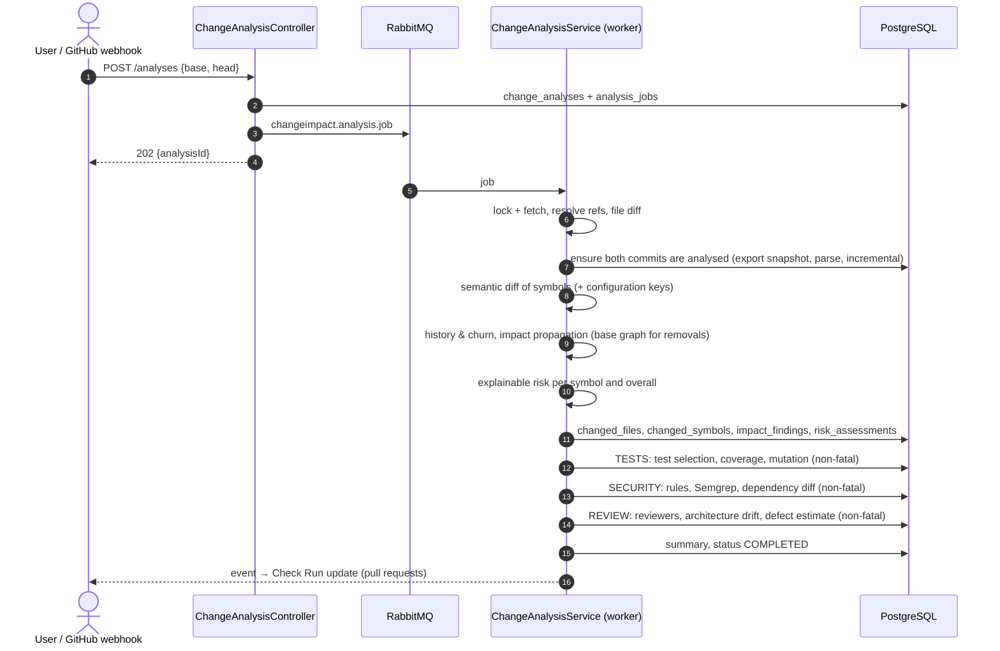
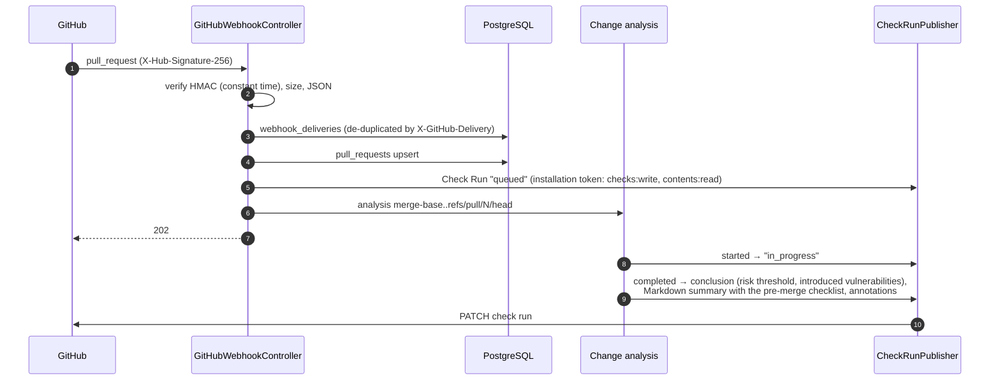

# ChangeImpact AI — System Architecture

ChangeImpact AI answers "what does this change affect, how risky is it, and what should be checked before merging?"
from the code itself: it parses every analysed commit into symbols and dependencies, compares commits semantically,
propagates changes through the dependency graph and explains the risk. Repository code is read, never executed.

## System overview



Only the web port is published; the backend, database, broker and cache are reachable inside the compose network
only (`docs/DEPLOYMENT.md`).

## Backend modules (`backend/src/main/java/com/changeimpact`)

| Package | Responsibility |
|---|---|
| `auth`, `common` | JWT authentication, refresh rotation, roles, rate limiting, production safety check, AI availability, secret redaction, metrics, error handling |
| `repository`, `ingestion` | Repositories, jobs, Git workspaces (JGit, per-repository lock, SSRF guard), indexing worker |
| `parser` | Language parsers (`parser/language`: Java via JavaParser + symbol solver; Python and `parser/language/ts`: JavaScript/TypeScript, PHP, C#, Go, Ruby, HTML, CSS via tree-sitter; SQL via its own reader), symbol and dependency extraction, incremental analysis |
| `graph`, `symbols` | Persisted symbols/dependencies → JGraphT graphs (class / member / package views, cached), centrality, code-intelligence API |
| `architecture` | Rule engine (cycles, forbidden dependencies, layered architecture, only-accessed-by) and rule management API; architecture digital twin |
| `diff`, `history` | Commit resolution and file diffs (rename detection, hunks), semantic change detection, configuration keys, commit history and churn |
| `analysis`, `impact`, `risk`, `reporting` | Change-analysis worker and stages, impact propagation, explainable risk, reviewers, JSON/Markdown reports |
| `testing`, `securityanalysis` | CI report ingestion (JaCoCo, JUnit, PIT, Dependency-Check), test selection, mutation quality; sensitive-code rules, Semgrep, dependency diff |
| `github` | Connected accounts, GitHub App (JWT, installation tokens), webhooks, pull requests, Check Runs |
| `architecture/twin` | Architecture digital twin: per-commit snapshots, hotspots, trends, comparison, history backfill |
| `defect` | Historical defect-prediction prototype (SZZ labels, logistic model, time-ordered evaluation) |
| `parser/libraries` | Dependency jars of analysed Java projects from Maven/Gradle builds (Maven Resolver, Maven Central only) for the symbol solver |
| `symbols/browser` | Read-only code browser: analysed files from the Git object database, symbols, resolved references |
| `dashboard`, `admin` | Team dashboard; job watchdog, retention, admin operations |
| `rag`, `ai` | Optional (Gemini): code-search index (chunks, embeddings, full-text + vector, RRF), AI review (evidence builder → one model call → deterministic validator), repository assistant, Gemini client with retries, fallback model and quota handling (`docs/AI_REVIEW.md`) |
| `com.github.javaparser.*` | Patched JavaParser classes (performance, overload resolution, determinism — `IMPLEMENTATION_NOTES.md`) |

The frontend (`frontend/src`) is a React 18 + Vite SPA: TanStack Query for data, React Flow for the dependency graph,
Recharts and hand-written SVG for the visualisations.

## Key flows

### Indexing a repository



### Change analysis (base → head)



### Pull request → Check Run



### Design rules

1. **Deterministic first.** Dependencies come from parsing and symbol resolution; unresolvable references are marked
   `UNRESOLVED`/`EXTERNAL`, never guessed. No language model is used anywhere in the analysis; the optional AI
   review only explains the finished report, must cite its evidence, and is validated deterministically.
2. **Evidence with every finding.** Impact findings carry their dependency path and evidence type; risk factors carry
   raw value, weight and contribution. Risk is a documented heuristic, never presented as a probability; the only
   probability shown (defect model) is an experimental, calibrated estimate, labelled as such.
3. **Commits are immutable.** Analyses are stored per commit SHA and reused; re-analysis happens only when the
   analyser or the enabled languages change (`analyzer_version`, `analysed_commit_languages`).
4. **Enrichment never fails an analysis.** Tests, security, reviewers, drift and the defect estimate record their own
   failures; the impact report always completes.
5. **Repository code is never executed.** Coverage, test and mutation data come from the user's CI.

## Phase 3: Change Impact Pipeline

```
POST /api/v1/analyses ──► change_analyses + analysis_jobs ──► RabbitMQ (changeimpact.analysis.job)
                                                                  │
                         ChangeAnalysisConsumer ◄─────────────────┘
                                  │
  1 resolve refs (JGit; optional merge-base)       diff/service/GitDiffService
  2 file diff with rename detection + hunks        diff/service/GitDiffService
  3 analyse base & head commits (snapshot export   analysis/service/CommitAnalysisService
    → JavaParser → symbols/dependencies per SHA;  IncrementalAnalysisPlanner (Phase 6): unaffected
    already analysed commits are reused, others   files copied from the closest analysed commit,
    planned incrementally)                         links re-resolved; equal to a full parse
  4 semantic diff of symbols (+ config keys)       diff/semantic/SemanticChangeDetector, ConfigChangeAnalyzer
  5 history & churn (incremental)                  history/service/HistoryService
  6 impact propagation (strongest weighted paths;  impact/service/ImpactPropagationService
    base graph for removals, head graph otherwise)
  7 explainable risk scoring                       risk/service/RiskScoringService
  8 persist report; JSON/Markdown rendering        reporting/service/ImpactReportService
```

Design rules: deterministic only (no LLM in Phase 3); every finding carries its dependency path and the
evidence type (verified reference vs transitive propagation); risk is a documented heuristic; each stage
commits its own progress so failures are persisted and visible.

## Phase 5: Test Intelligence, Security Impact and GitHub Automation

```
CI ──POST /repositories/{id}/reports──► quality_reports (+ coverage_files, test_executions,
     (JaCoCo, JUnit, PIT, Dependency-Check)   mutation_results, dependency_vulnerabilities)   per commit SHA

GitHub ──POST /webhooks/github──► HMAC-SHA256 verify ─► delivery de-dup (X-GitHub-Delivery UNIQUE)
                                    │ pull_request opened/synchronize/reopened/ready_for_review
                                    ├─► pull_requests upsert ─► change analysis (merge-base..head, refs/pull/N/head)
                                    │                         └► Check Run "queued" (created before commit)
                                    ├─► push to default branch ─► re-index
                                    └─► installation events ─► github_app_installations

Change analysis worker (Phase 3 stages 1–7, then):
  7b changed-line coverage → risk factor          testing/coverage/CoverageService (JaCoCo of the head commit only)
  8  persist report (status stays RUNNING)
  9  TESTS: reverse graph walk to @Test methods,   testing/recommendations/service/TestSelectionService
     lifecycle expansion, executed status,        testing/mutation/MutationQualityService
     coverage gaps, scenarios, PIT mutation score
 10  SECURITY: sensitive-code rules (call targets, securityanalysis/service/SecurityAnalysisService
     annotations, names), Semgrep on changed +     (SecuritySensitivityClassifier, SemgrepRunner,
     directly impacted files, build-file dependency  BuildDependencyDiff)
     diff joined with Dependency-Check CVEs
 11  COMPLETED ─► ChangeAnalysisEvent ─► CheckRunPublisher: in_progress / completed
                                         (conclusion, Markdown summary ≤ 65,535 chars, annotations in batches of 50)
```

Design rules:
- **Enrichment never fails an analysis.** A failing test or security stage is recorded in the summary
  (`tests.status = FAILED`, `security.status = FAILED`) and the impact report is still completed.
- **Reports only count for their exact commit.** Coverage, test results and mutation data are line-based, so
  they are used only when the uploaded report's commit equals the analysis head commit.
- **Measured beats inferred.** When changed-line coverage is measured, the static "missing test references"
  factor is kept in the breakdown with weight 0.
- **Repository code is never executed.** Semgrep only reads files from a private export of the head commit;
  coverage, test and mutation data come from the user's CI.
- **Introduced vulnerabilities vs review hints.** Only Semgrep matches in changed lines and known CVEs in added or
  changed dependencies can fail a Check Run; "this change touches authentication code" is a review hint.
- **GitHub problems never block analyses**; they are recorded on the pull request (`FAILED_TO_PUBLISH`).
- **One Check Run per pull request event**: when several users connected the same repository, only the
  earliest-connected copy publishes.

## Security Architecture
1. **Stateless JWTs**: Access tokens expire in 15 minutes and carry HMAC-SHA256 signatures with minimal claims (userId, email, username).
2. **Refresh Token Rotation**: Refresh tokens expire in 7 days, stored strictly as SHA-256 hashes in PostgreSQL.
3. **AES-256-GCM Token Encryption**: Connected GitHub tokens are encrypted before saving and decrypted on-the-fly for JGit or WebClient operations.
4. **JGit Workspace Sandbox**: Operations are confined to isolated directory structures (`changeimpact/workspaces/<uuid>`). Path traversal and symlink escapes are actively checked and rejected.

5. **GitHub webhooks**: public endpoint, but every delivery must carry a valid `X-Hub-Signature-256`
   (HMAC-SHA256 over the raw body, constant-time comparison); without a configured secret the endpoint answers 503.
   Deliveries are de-duplicated by `X-GitHub-Delivery`; bodies are size-limited and must be JSON.
6. **GitHub App credentials**: the App's private key is read once from a file or secret and never logged; App JWTs
   live ≤ 10 minutes; installation tokens are requested per repository with only `checks:write` + `contents:read`
   and cached until 5 minutes before expiry. Error messages are scrubbed of tokens before being stored.
7. **Untrusted reports**: XML reports are parsed with StAX with DTDs and external entities disabled (XXE-safe);
   uploads are size-limited; Semgrep runs without a shell, with a timeout, offline (`--metrics=off`), and rejects
   target paths containing `..`.

## Phase 6: Architecture Digital Twin

```
analysed commit (symbols + dependencies, any path: indexing, change analysis, history backfill)
        │
        ▼
ArchitectureTwinService ── SQL aggregates per package / file ── JGraphT SCCs (package cycles) ── dependency order
        │                                  │
        ▼                                  ▼
architecture_snapshots (per commit)    hotspots (churn × complexity, on request)
        │
        ├── trend (≤ 40 commits)        ├── compare(base, head) → drift findings
        └── UI: code city · hotspots · dependency matrix · main sequence · trends · compare

ArchitectureHistoryService (ARCHITECTURE_HISTORY job, repository lock): sample N first-parent commits →
CommitAnalysisService.ensureAnalyzed (incremental) → snapshot
```

## Phase 6: Historical defect model (experimental)

```
DEFECT_MODEL job (repository lock)
  JitDatasetBuilder ── up to 5,000 non-merge commits, Kamei JIT features from prior history only
  SzzLabeler        ── bug-fix commits (message heuristic) → blame of deleted/modified lines → bug-introducing commits
  DefectModelEvaluator
        warm-up 10 % | train 60 % (labels: fixes before the cutoff) | test 25 % | immature 5 %
        logistic regression vs churn and prior baselines → gate (≥ 30/10 positives, AUC ≥ 0.65, +0.02 over churn)
  defect_models ── evaluation always; coefficients + scored commits only when ACCEPTED
Change analysis REVIEW stage ── estimates for the range's commits from an accepted model (never part of the risk score)
```
Details and results: `docs/DEFECT_MODEL.md`.

## Phase 6: Multi-language analysis

```
LanguageRegistry (ANALYSIS_LANGUAGES=all) ── JavaLanguageParser (JavaParser, incremental)
                                         ├─ PythonLanguageParser (tree-sitter)
                                         ├─ ts/TreeSitterParser: JavaScript·TypeScript·React, PHP, C#, Go, Ruby, HTML, CSS
                                         └─ ts/SqlLanguageParser (statement reader)
        └─ same model: ParsedSourceFile → source_files (language) / symbols / dependencies
           → graph, semantic diff, impact, risk, tests, reports, twin, defect model unchanged
```
Details, per-language models and limitations: `docs/MULTI_LANGUAGE.md`.
