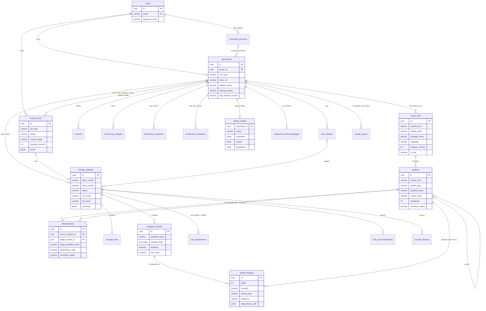

# ChangeImpact AI — Database Schema Reference

Managed by **Flyway**.

## Entity-relationship overview

Core tables and their foreign keys (taken from the live schema at V12; operational tables such as
`refresh_tokens`, `roles`, `repository_branches`, `repository_indexes`, `webhook_deliveries`,
`github_app_installations` and the quality-report detail tables are left out for readability).

## Schema Migrations

### V1 — Users, Roles and Security Foundation (`V1__users_and_roles.sql`)
- `roles`: Standard user and administrator role definitions.
- `users`: Core account table with BCrypt passwords and lockout protection.
- `user_roles`: Mapping table linking users and assigned roles.
- `refresh_tokens`: SHA-256 hashed refresh tokens for stateless token rotation.

---

### V2 — GitHub Integration and Repository Management (`V2__github_and_repositories.sql`)
- `connected_accounts`: AES-256-GCM encrypted OAuth/PAT tokens.
- `repositories`: Connected GitHub projects with branch and status tracking.
- `repository_branches`: Tracked Git branches.
- `commits`: Commit history imported via JGit for diff tracking.
- `repository_indexes`: Audit records of indexing execution runs and stats.
- `analysis_jobs`: RabbitMQ background job tracking table with JSON payloads.
- `webhook_deliveries`: Deduplication log for GitHub webhooks.

---

### V3 — Symbols, Dependencies, and Architecture Rules (`V3__symbols_and_dependencies.sql`)

#### `source_files`
| Column | Type | Constraints | Description |
|---|---|---|---|
| `id` | UUID | PRIMARY KEY | File identifier |
| `repository_id` | UUID | FK -> repositories(id) | Repository |
| `commit_sha` | VARCHAR(255) | NOT NULL | Associated commit |
| `relative_path` | VARCHAR(1024) | NOT NULL | Relative path in repo |
| `package_name` | VARCHAR(512) | | Package name |
| `lines_of_code` | INT | NOT NULL, DEFAULT 0 | Total LOC |
| `size_bytes` | BIGINT | NOT NULL, DEFAULT 0 | File size in bytes |
| `is_test` | BOOLEAN | NOT NULL, DEFAULT FALSE | Test file flag |

#### `symbols`
| Column | Type | Constraints | Description |
|---|---|---|---|
| `id` | UUID | PRIMARY KEY | Symbol identifier |
| `repository_id` | UUID | FK -> repositories(id) | Repository |
| `source_file_id`| UUID | FK -> source_files(id) | File location |
| `commit_sha` | VARCHAR(255) | NOT NULL | Commit SHA |
| `symbol_type` | VARCHAR(50) | NOT NULL | CLASS, INTERFACE, RECORD, ENUM, METHOD, CONSTRUCTOR, FIELD |
| `qualified_name`| VARCHAR(1024)| NOT NULL | Full symbol signature |
| `simple_name` | VARCHAR(255) | NOT NULL | Simple identifier |
| `parent_symbol_id`| UUID | FK -> symbols(id) | Enclosing class/record |
| `return_type` | VARCHAR(512) | | Method/field type |
| `parameters` | TEXT | | Comma-separated parameter types |
| `visibility` | VARCHAR(20) | NOT NULL | PUBLIC, PROTECTED, PACKAGE_PRIVATE, PRIVATE |
| `is_static` | BOOLEAN | NOT NULL | Static modifier |
| `is_abstract` | BOOLEAN | NOT NULL | Abstract modifier |
| `is_final` | BOOLEAN | NOT NULL | Final modifier |
| `annotations` | TEXT[] | | Applied annotations |
| `start_line` | INT | NOT NULL | 1-based start line |
| `end_line` | INT | NOT NULL | 1-based end line |
| `resolution_status`| VARCHAR(50)| NOT NULL | RESOLVED, PARTIAL, UNRESOLVED, EXTERNAL |

#### `dependencies`
| Column | Type | Constraints | Description |
|---|---|---|---|
| `id` | UUID | PRIMARY KEY | Dependency identifier |
| `repository_id` | UUID | FK -> repositories(id) | Repository |
| `commit_sha` | VARCHAR(255) | NOT NULL | Commit SHA |
| `source_symbol_id`| UUID | FK -> symbols(id) | Source symbol |
| `target_symbol_id`| UUID | FK -> symbols(id) (nullable) | Internal target symbol |
| `target_qualified_name`| VARCHAR(1024)| NOT NULL | Target signature |
| `dependency_type`| VARCHAR(50)| NOT NULL | EXTENDS, IMPLEMENTS, METHOD_CALL, CONSTRUCTOR_CALL, FIELD_ACCESS, etc. |
| `is_external` | BOOLEAN | NOT NULL, DEFAULT FALSE | External library / JDK flag |
| `source_location_line`| INT | | Line of call/usage |
| `resolution_status`| VARCHAR(50)| NOT NULL | RESOLVED, UNRESOLVED |

#### `architecture_rules`
Stores custom and system-wide boundary validation rules (e.g., `CIRCULAR_DEPENDENCY`, `LAYER_VIOLATION`).

#### `architecture_violations`
Records all circular loops and illegal layer dependencies detected by JGraphT and ArchUnit algorithms.

### V4 / V5 — Refresh token IP column fix; job progress tracking (`current_stage`, `current_message`, `progress_percent`)

### V6 — Change impact analysis (`V6__change_impact_analysis.sql`)

**Altered**
- `symbols`: `content_hash` (SHA-256 of the declaration printed without comments; types: header only),
  `annotation_text` (full annotation expressions), `complexity` (cyclomatic, methods/constructors)
- `commits`: `additions`, `deletions`, `is_merge`, `is_revert`, `is_bugfix` (heuristic labels), `history_scanned`; index on `(repository_id, commit_date DESC)`

**New tables** (all scoped by `repository_id` directly or through `analysis_id`; children cascade on delete)

| Table | Purpose | Key columns |
|---|---|---|
| `commit_file_changes` | Files touched per commit (diff vs first parent, merges excluded) | `UNIQUE(repository_id, commit_sha, path)`, `change_type`, `additions`, `deletions` |
| `change_analyses` | One base→head comparison | `base_ref/head_ref` (requested), `base_commit/head_commit` (resolved), `status`, `options` JSONB, `summary` JSONB, `risk_score`, `risk_level`, `job_id` → `analysis_jobs` |
| `changed_files` | File-level changes | `change_type`, `file_category`, `additions`, `deletions`, `hunks` JSONB |
| `changed_symbols` | Semantically classified symbol changes | `change_kinds TEXT[]`, `breaking`, `base_symbol_id`/`head_symbol_id` → `symbols` (SET NULL), `details` JSONB, dependents counts, risk |
| `impact_findings` | Affected symbol per changed symbol | `depth`, `strength`, `impact_type`, `evidence`, `also_changed`, `is_test`, `graph_commit`, `dependency_path` JSONB |
| `risk_assessments` | Explainable risk per changed symbol (`changed_symbol_id`) or per analysis (NULL) | `score`, `level`, `factors` JSONB |

### V7 — Testing, security and GitHub App (`V7__testing_security_github.sql`)
| Table | Purpose | Key columns |
|---|---|---|
| `quality_reports` | One uploaded CI report per row | `repository_id`, `commit_sha` (full SHA), `report_type` (JACOCO, JUNIT, PIT, DEPENDENCY_CHECK), `summary` JSONB |
| `coverage_files` | JaCoCo line coverage per source file | `source_path` (package-relative), `covered_lines INT[]`, `missed_lines INT[]` |
| `coverage_methods` | JaCoCo per-method counters | `class_name`, `method_name`, `method_desc`, `first_line`, line/branch covered/missed |
| `test_executions` | JUnit/Surefire test cases | `class_name`, `method_name`, `status` (PASSED, FAILED, ERROR, SKIPPED), `duration_ms`, `message` |
| `mutation_results` | PIT mutants | `class_name`, `method_name`, `line_number`, `mutator`, `status`, `killing_test` |
| `dependency_vulnerabilities` | Dependency-Check findings | `package_id` (purl), `vulnerability`, `severity`, `cvss_score`, `cwes TEXT[]` |
| `test_recommendations` | Test intelligence per analysis | `category` (DIRECT, INDIRECT, MISSING_TEST, SCENARIO), `priority`, `test_class/method`, `execution_status`, `depth`, `evidence` JSONB |
| `security_findings` | Security impact per analysis | `source` (STATIC_RULES, SEMGREP, BUILD_DIFF, DEPENDENCY_CHECK), `category`, `severity`, `relation` (CHANGED, IMPACTED, DEPENDENCY), location, `cwe` |
| `github_app_installations` | App installations | `installation_id` UNIQUE, `account_login`, `repositories` JSONB, `suspended` |
| `pull_requests` | PRs seen through webhooks | UNIQUE (`repository_id`, `number`), head/base SHAs, `last_analysis_id`, `risk_*`, `check_run_id`, `check_status`, `check_conclusion`, `check_error` |

Changed tables:
- `webhook_deliveries` (created in V2, unused until now) is **extended, not recreated**: `installation_id`, `status`
  (PROCESSING, ACCEPTED, IGNORED, FAILED), `detail`, `analysis_ids` JSONB. `delivery_id` stays UNIQUE (de-duplication).
- `change_analyses`: `trigger` (MANUAL, PULL_REQUEST) and `pull_request_id` (FK, `ON DELETE SET NULL`).

All analysis-owned rows cascade on analysis deletion; report rows cascade on report deletion.

### V8 — Index review (`V8__drop_redundant_indexes.sql`)
No table changes. Five indexes that no query used were dropped (they cost time on every symbol/dependency insert;
`dependencies` is the largest table):
- `idx_analysis_jobs_idempotency_key`, `idx_source_files_repo_commit`: duplicates of the indexes behind UNIQUE
  constraints with the same leading columns.
- `idx_deps_target_name`, `idx_deps_type`, `idx_symbols_type`: every query on these columns also filters by
  `(repository_id, commit_sha)`, served by `idx_deps_repo_commit` / `idx_symbols_repo_commit` (0–2 scans observed).

### V9 — Analyser version (`V9__analyzer_version.sql`)
- `source_files.analyzer_version INT NOT NULL DEFAULT 0`: version of the symbol/dependency extraction that produced the
  commit's rows (`CodeAnalysisService.ANALYZER_VERSION`, currently 1; rows from before V9 are 0). Incremental analysis
  copies rows only from commits whose files all carry the current version, so results of an older analyser are never
  carried forward; older commits stay as they are for the reports that reference them.

### V10 — Architecture digital twin (`V10__architecture_snapshots.sql`)
| Table | Purpose | Key columns |
|---|---|---|
| `architecture_snapshots` | Structural model of one analysed commit (production code) | UNIQUE (`repository_id`, `commit_sha`), `twin_version`, `source_fingerprint` (rebuilt when the commit is re-analysed), `commit_date`, `summary` / `packages` / `edges` / `cycles` JSONB |

`analysis_jobs.job_type` additionally allows `ARCHITECTURE_HISTORY` (history backfill job).

### V11 — Defect model (`V11__defect_models.sql`)
| Table | Purpose | Key columns |
|---|---|---|
| `defect_models` | One historical defect model per repository (P6-6, experimental) | PK `repository_id` → `repositories` (CASCADE), `status`, `reason`, `head_commit`, `model_version` (pipeline version; older ones are not used), `dataset` / `evaluation` JSONB (always), `model` JSONB + `threshold` + `predictions` JSONB (accepted models only), `trained_at` |

`analysis_jobs.job_type` additionally allows `DEFECT_MODEL`.

### V12 — Languages (`V12__languages.sql`)
- `source_files.language VARCHAR(20) NOT NULL DEFAULT 'java'` — language of the analysed file: `java`, `python`, `javascript` (also TypeScript/JSX/TSX), `php`, `csharp`, `go`, `ruby`, `html`, `css`, `sql`. No migration was needed for the later languages; database objects are symbols too (`db:owners`, `db:owners#first_name`).
- `symbols.symbol_type` additionally takes `MODULE` and `FUNCTION` (Python; the column is free text, no constraint change).

| Table | Purpose | Key columns |
|---|---|---|
| `analysed_commit_languages` | Languages (with parser versions, e.g. `java@3`, `python@3`, `javascript@1`, `css@2`) each commit was analysed with; a commit missing an enabled language/version is re-analysed. No row = Java only. | PK (`repository_id`, `commit_sha`), `languages VARCHAR(20)[]`, `analysed_at` |

### V13 — AI review and code search (`V13__ai_review_rag.sql`)
`CREATE EXTENSION vector` (pgvector, already in the `pgvector/pgvector:pg16` image).

| Table | Purpose | Key columns |
|---|---|---|
| `code_chunks` | One searchable chunk per method/constructor/function (whole body, ≤ 150 lines) and per type/module header (≤ 25 lines) of an indexed commit, secret-redacted | `repository_id` (CASCADE), `commit_sha`, `symbol_id` (SET NULL), `qualified_name`, `symbol_type`, `file_path`, `start_line`, `end_line`, `content`, `content_hash` (embeddings are reused across commits by hash + model), `embedding vector(768)` (HNSW, cosine), `embedding_model`, generated `tsv` (GIN; redefined in V14). UNIQUE (`repository_id`, `commit_sha`, `qualified_name`, `start_line`) |
| `ai_reviews` | AI reviews of analyses | `analysis_id` (CASCADE), `job_id`, `status`, `model`, `prompt_version`, `prompt_tokens`, `output_tokens`, `latency_ms`, `evidence` / `result` / `validation` JSONB, `error_message`, `created_at`, `completed_at` |
| `assistant_messages` | Assistant questions and validated answers | `repository_id` (CASCADE), `user_id` (CASCADE), `commit_sha`, `question`, `answer` JSONB, `model`, tokens, `latency_ms`, `created_at` |

`analysis_jobs.job_type` additionally allows `RAG_INDEX` and `AI_REVIEW`.

### V15 — Architecture rule management (`V15__architecture_rule_management.sql`)
- `architecture_rules.updated_at`.
- `architecture_rule_overrides` (PK `repository_id`, `rule_id`; both CASCADE): `enabled` — a repository switching a global default rule off (or on again).

### V16 — Library classpath per commit (`V16__commit_libraries.sql`)
- `commit_libraries` (PK `repository_id`, `commit_sha`): `status` (RESOLVED, PARTIAL, FAILED, NO_BUILD_FILE, DISABLED), `build_system`, `fingerprint` (SHA-256 of the sorted artifact list; incremental analysis reuses rows only between commits with the same fingerprint), `jar_count`, `total_bytes`, `artifacts` JSONB, `message`, `resolve_ms`, `resolved_at`.

### V14 — Weighted full-text for code search (`V14__rag_weighted_fulltext.sql`)
`code_chunks.tsv` regenerated as `setweight(name words, 'A') || setweight(body words, 'D')`, identifiers split at camelCase
and punctuation; search ranks with `ts_rank(tsv, q, 1)` (length-normalised). Measured effect in docs/AI_REVIEW.md.

