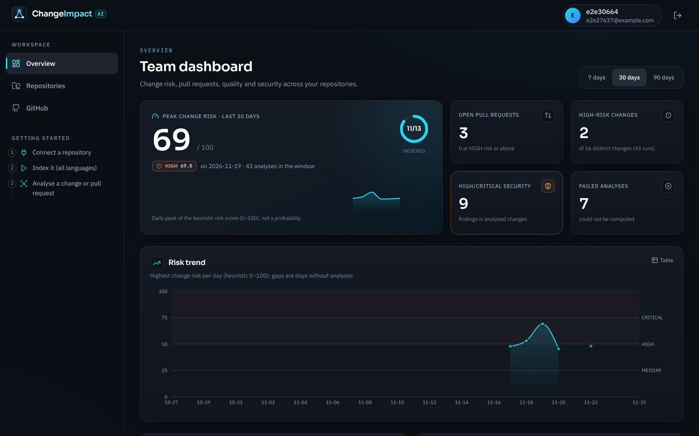
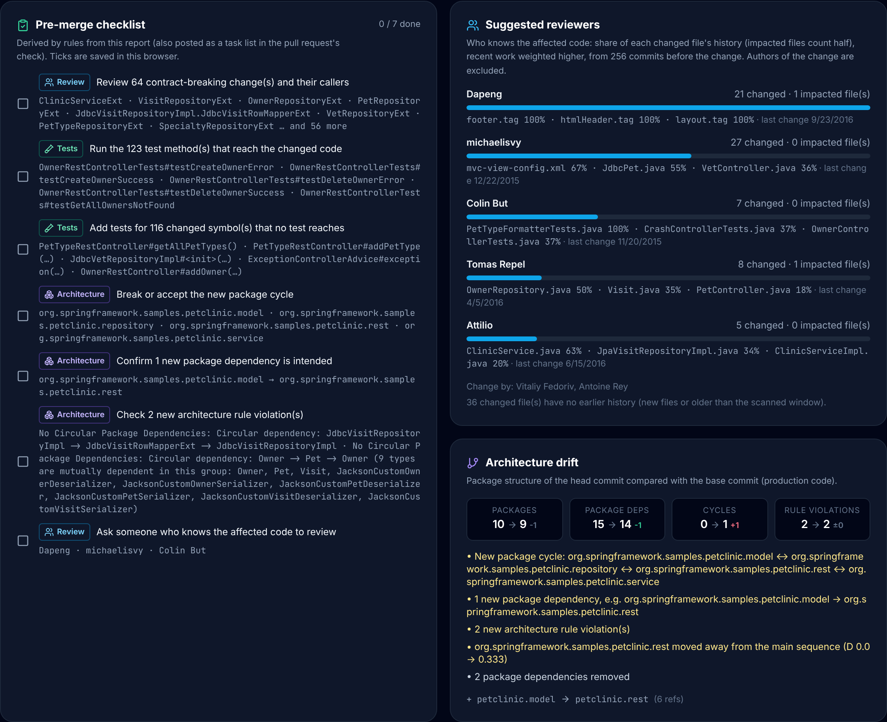
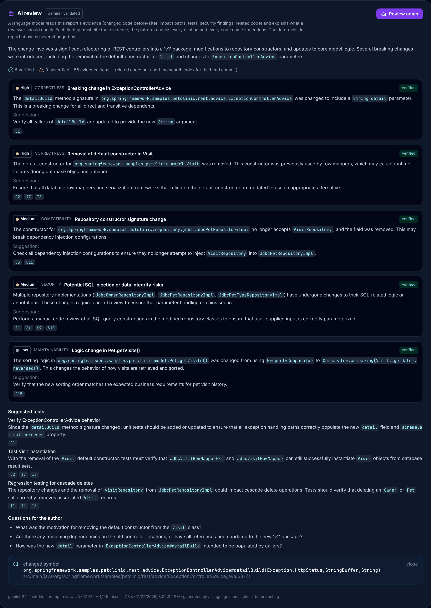
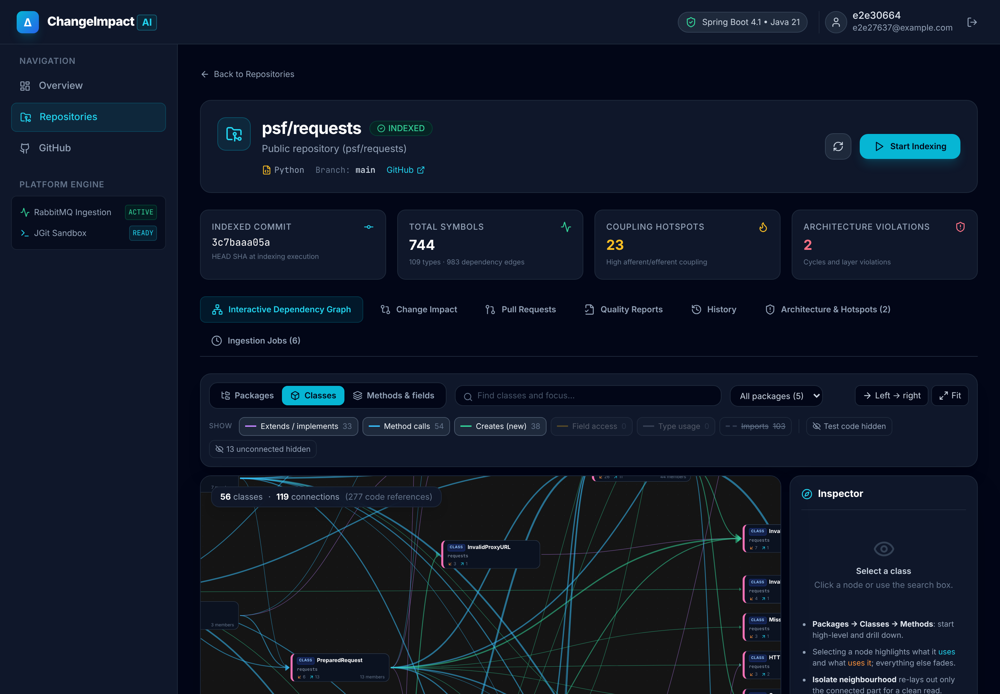
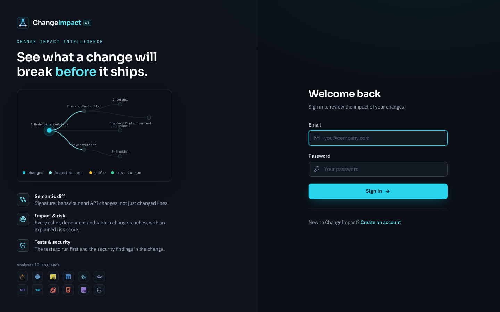
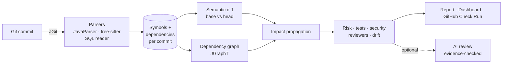

<div align="center">


# ChangeImpact AI

### See what a change will break — *before* it ships.

AST-driven change-impact analysis for pull requests: semantic diffs, dependency-traced impact,
an explainable risk score, the tests to run first and the security findings in the change.

[**Live demo**](https://changeimpact-ai.onrender.com) ·
[Documentation](#documentation) ·
[Quick start](#quick-start) ·
[Architecture](#how-it-works)




</div>

---

## Why ChangeImpact AI

Code review asks three questions on every pull request:

> **What does this change affect? How risky is it? What should be checked before it is merged?**

A line diff can't answer them. ChangeImpact AI answers them **from the code itself**:

- it parses every commit into symbols and resolved dependencies;
- it compares two commits **semantically**, not line by line;
- it follows each change through the dependency graph to the code, tables and tests it reaches;
- it **explains** the risk, factor by factor.

Every finding carries its evidence. Repository code is **read, never executed**. The analysis itself is
deterministic: no language model computes changes, dependencies, impact, tests or risk.

## Table of contents

- [Live demo](#live-demo)
- [Features](#features)
- [Supported languages](#supported-languages)
- [Screenshots](#screenshots)
- [How it works](#how-it-works)
- [Quick start](#quick-start)
- [Local development](#local-development)
- [Deployment](#deployment)
- [Tech stack](#tech-stack)
- [Documentation](#documentation)
- [Project status](#project-status)
- [License](#license)

## Live demo

**🔗 <https://changeimpact-ai.onrender.com>**

Register an account, connect a public GitHub repository (for example `spring-projects/spring-petclinic`), index it,
then analyse two commits or a pull request.

> [!NOTE]
> The demo runs on Render's free tier. After a period of inactivity the backend sleeps, so the **first request can
> take up to a minute** while it wakes. Later requests are fast.

## Features

<table>
<tr>
<td width="50%" valign="top">

### 🔍 Change impact analysis
- **Semantic changes**: signatures, return types, visibility, inheritance, REST mappings, transactions, security
  annotations and configuration keys. Comment-only edits are ignored; breaking changes are flagged.
- **Impact**: every affected symbol with its full dependency path, strength and evidence.
- **Explainable risk (0–100)**: each factor's value, weight and contribution is shown. It is never presented as a
  probability.
- **Pre-merge checklist** and **suggested reviewers** from recency-weighted ownership.
- **Blast-radius sunburst**, analysis timeline, Markdown/JSON reports.

</td>
<td width="50%" valign="top">

### 🧪 Test intelligence
- Uses the JaCoCo, JUnit, PIT and Dependency-Check reports from your CI.
- The **tests that reach the change**, ordered to run first.
- **Changed-line coverage** and coverage gaps.
- **Mutation quality** of the changed methods.

### 🛡️ Security impact
- Sensitive-code rules.
- **Semgrep** on changed and impacted files, with rules for Java, Python, JS/TS, PHP, C#, Go and Ruby.
- Dependency changes joined with known **CVEs**.
- Introduced vulnerabilities kept separate from review hints.

</td>
</tr>
<tr>
<td valign="top">

### 🕸️ Interactive dependency graph
- Package, class and member views.
- Focus, isolate a neighbourhood, filter by relationship.
- **Centrality** ranks the types that broker dependencies (betweenness) or that everything builds on (PageRank).

### 🏛️ Architecture digital twin
- Per-commit snapshots: **code city**, churn × complexity **hotspots**, **dependency structure matrix**, main
  sequence and trends.
- Commit-to-commit **drift**: new cycles, dependencies and rule violations.
- **Architecture rules** (layers, forbidden dependencies, cycles) checked on every analysis.

</td>
<td valign="top">

### 🤖 GitHub automation
- A **GitHub App** analyses pull requests and publishes **Check Runs**: summary, checklist and annotations.
- Webhooks are HMAC-verified and de-duplicated.

### ✨ AI review, code search and assistant *(optional)*
- With a Gemini key, a model **explains** an analysis: risks to check, tests to add, questions for the author.
- Every claim must **cite numbered evidence**; the platform checks each citation and code name and marks findings
  *verified* or *unverified*.
- Hybrid code search (full-text + vector) and a repository assistant.
- Without a key, everything else runs unchanged.

</td>
</tr>
<tr>
<td valign="top">

### 📝 Code browser
- Read-only **Monaco** view of any analysed commit.
- Ctrl/⌘-click or F12 jumps to the declaration resolved by the analysis.
- Hovers show how each reference was resolved; a panel lists callers and callees.

</td>
<td valign="top">

### ⚙️ Production ready
- Production profile with safety checks, rate limiting and tenant isolation.
- **Prometheus** metrics, a **Grafana** dashboard, optional OpenTelemetry.
- Docker images, backup and restore scripts.
- Experimental **defect model** trained on the repository's own history, used only when it beats the baselines.

</td>
</tr>
</table>

## Supported languages

All languages are analysed by default (`ANALYSIS_LANGUAGES=all`), behind one common parser abstraction.

| Language | Parser | Typical projects |
|---|---|---|
| **Java** | JavaParser + symbol solver + the project's dependency jars | Spring, Jakarta EE, libraries |
| **Python** | tree-sitter | Django, Flask, FastAPI, libraries |
| **JavaScript / TypeScript / React** | tree-sitter (JS, TS, TSX grammars) | React, Next.js, Node/Express, Angular services |
| **PHP** | tree-sitter | Laravel, Symfony, WordPress plugins |
| **C# / .NET** | tree-sitter | ASP.NET Core, class libraries |
| **Go** | tree-sitter + `go.mod` | Services, CLIs |
| **Ruby** | tree-sitter | Rails, Sinatra, gems |
| **HTML and templates** | tree-sitter | Thymeleaf, Jinja/Django, Twig, static sites |
| **CSS** | tree-sitter | Stylesheets, CSS Modules |
| **SQL** | Own statement reader | Schemas, Flyway/Liquibase migrations, stored code |

**Cross-language links**: pages to the scripts, stylesheets and templates they include; `class` attributes and CSS
Modules to selectors; JPA, Rails and EF models and embedded SQL to the tables the repository's SQL defines.
Details: [docs/MULTI_LANGUAGE.md](docs/MULTI_LANGUAGE.md).

## Screenshots

| Change impact analysis | Code browser |
|---|---|
|  |  |
| **Blast radius** | **Architecture twin: code city** |
|  |  |
| **Checklist, reviewers and drift** | **AI review with verified evidence** |
|  |  |
| **Dependency graph** | **Sign in** |
|  |  |

## How it works



1. **Index.** A commit is cloned with JGit and parsed into symbols and resolved dependencies. Each analysed commit is
   stored once and reused; new commits are analysed incrementally from the closest analysed one.
2. **Diff.** Base and head are compared symbol by symbol, giving semantic changes rather than changed lines.
3. **Propagate.** Each change is traced through the dependency graph to everything it reaches, with paths and evidence.
4. **Assess.** Risk, test selection, coverage, security findings, reviewers and architecture drift are computed.
5. **Report.** Results appear in the dashboard, as Markdown/JSON reports and as a GitHub Check Run.

Indexing and analyses run as **RabbitMQ** jobs, with per-repository locking, dead-letter queues and a watchdog.
More: [ARCHITECTURE.md](ARCHITECTURE.md) · [DATABASE_SCHEMA.md](DATABASE_SCHEMA.md).

## Quick start

Run the whole stack with Docker:

```bash
git clone https://github.com/dharshan7200/ChangeImpactAI.git
```

```bash
cd ChangeImpactAI
```

```bash
./scripts/generate-env.sh http://localhost:8088
```

```bash
docker compose -f docker-compose.full.yml up -d --build
```

`generate-env.sh` writes a `.env` file with random secrets. Then open <http://localhost:8088>, register, connect a
public repository, index it and analyse two commits.

## Local development

**Requirements:** Java 21, Maven 3.9, Node 22, Docker.

Start PostgreSQL (pgvector), RabbitMQ and Redis:

```bash
docker compose up -d
```

Run the backend on <http://localhost:8080> (dev profile, Flyway migrations run automatically):

```bash
cd backend && mvn spring-boot:run
```

Run the frontend on <http://localhost:5173>, in a second terminal:

```bash
cd frontend && npm ci && npm run dev
```

**Tests.** `cd backend && mvn test` runs the backend tests; it needs Docker for Testcontainers. `cd frontend && npm run build` type-checks and builds the frontend. See [docs/TESTING.md](docs/TESTING.md).

## Deployment

| Target | How |
|---|---|
| **Render** (live demo) | [`render.yaml`](render.yaml) deploys the backend as a Docker web service and the frontend as a static site. Secrets such as `DB_PASSWORD` and `GEMINI_API_KEY` are set in the Render dashboard, never in the repository. |
| **Docker Compose** | `docker-compose.full.yml` runs backend, frontend (nginx), PostgreSQL, RabbitMQ and Redis. |
| **Production** | TLS, GitHub App setup, monitoring, backups, upgrades and troubleshooting: [docs/DEPLOYMENT.md](docs/DEPLOYMENT.md). |

Every environment variable is documented in [docs/CONFIGURATION.md](docs/CONFIGURATION.md).

## Tech stack

| Layer | Technologies |
|---|---|
| **Backend** | Java 21 · Spring Boot 4.1 · Spring Security 7 · Spring AI 2.0 (optional) · JavaParser 3.28 · tree-sitter · JGraphT · JGit · Flyway |
| **Data & messaging** | PostgreSQL 16 + pgvector · RabbitMQ 3.13 · Redis 7 |
| **Frontend** | React 18 · Vite 6 · TypeScript · Tailwind CSS · TanStack Query · React Flow · Recharts · Monaco |
| **Analysis tools** | Semgrep · JaCoCo · JUnit · PIT · OWASP Dependency-Check |
| **Operations** | Docker · Micrometer/Prometheus · Grafana · OpenTelemetry (optional) · Render |

Versions and compatibility notes: [TECH_STACK.md](TECH_STACK.md).

## Documentation

| Document | Contents |
|---|---|
| [ARCHITECTURE.md](ARCHITECTURE.md) | System overview, backend modules, sequence diagrams, design rules |
| [API_DOCUMENTATION.md](API_DOCUMENTATION.md) | REST API (`/api/v1`) |
| [DATABASE_SCHEMA.md](DATABASE_SCHEMA.md) | ER diagram and every migration |
| [SECURITY.md](SECURITY.md) | Threats, controls with evidence, residual risks |
| [docs/DEPLOYMENT.md](docs/DEPLOYMENT.md) | Install, TLS, monitoring, backups, upgrades, troubleshooting |
| [docs/CONFIGURATION.md](docs/CONFIGURATION.md) | Every environment variable |
| [docs/MULTI_LANGUAGE.md](docs/MULTI_LANGUAGE.md) | Analysed languages, cross-language links, limits |
| [docs/LIBRARY_RESOLUTION.md](docs/LIBRARY_RESOLUTION.md) | Dependency jars for type resolution: safety and measured effect |
| [docs/AI_REVIEW.md](docs/AI_REVIEW.md) | AI review, code search, assistant: validation and measured results |
| [docs/DEFECT_MODEL.md](docs/DEFECT_MODEL.md) | Defect prediction: method, results, limitations |
| [docs/TESTING.md](docs/TESTING.md) | How to run the tests and what they cover |
| [docs/VERIFICATION.md](docs/VERIFICATION.md) | Feature-by-feature verification on the production stack |
| [docs/EVALUATION.md](docs/EVALUATION.md) | How each claim was checked, results, threats to validity |
| [docs/LIMITATIONS.md](docs/LIMITATIONS.md) | Known limitations, consolidated |
| [docs/DEMO.md](docs/DEMO.md) | Guided demo walkthrough |

## Project status

| Phase | Scope | Status |
|---|---|---|
| 1 | Foundation, GitHub ingestion | ✅ Done |
| 2 | Static code intelligence, dependency graph | ✅ Done |
| 3 | Change detection, impact analysis, risk | ✅ Done |
| 4 | AI review, code search (RAG), repository assistant | ✅ Done (optional, Gemini) |
| 5 | Test intelligence, security analysis, GitHub automation | ✅ Done |
| 6 | Production hardening, architecture twin, deployment, defect model, multi-language | ✅ Done |

Known limitations are listed openly in [docs/LIMITATIONS.md](docs/LIMITATIONS.md).

## License

No license has been chosen yet. Add one before distributing the project.

---

<div align="center">
<sub>Built with Java, Spring Boot and React · <a href="https://changeimpact-ai.onrender.com">changeimpact-ai.onrender.com</a></sub>
</div>
