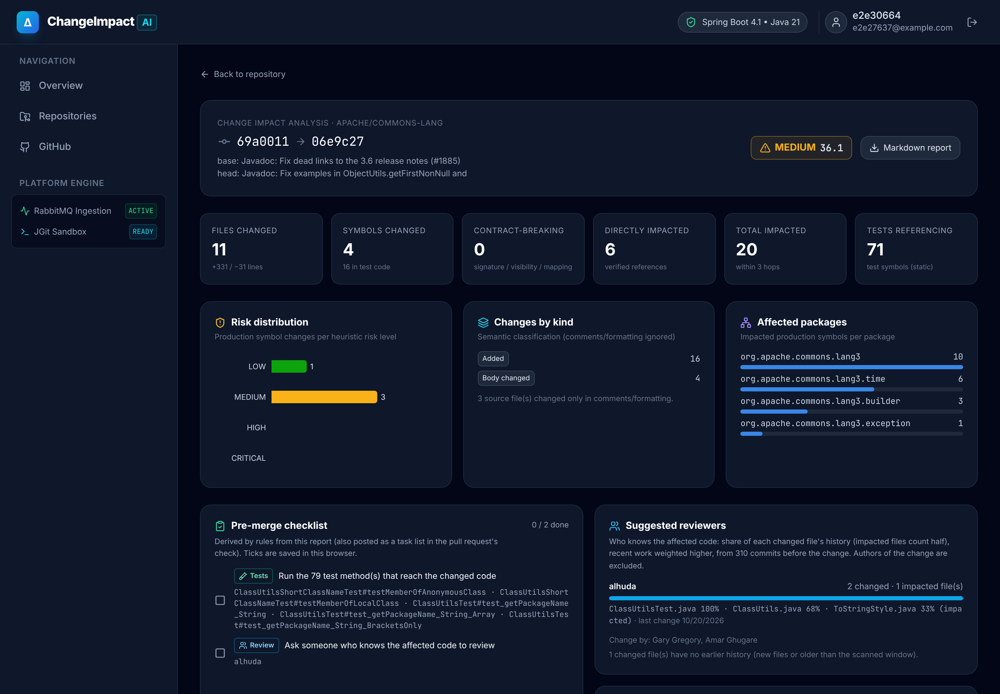
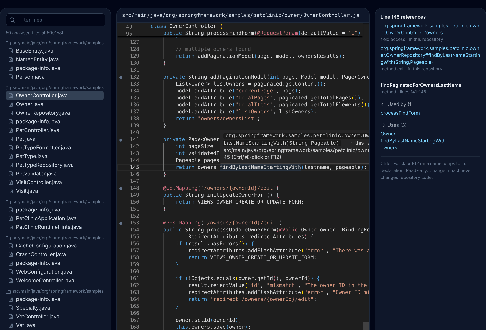
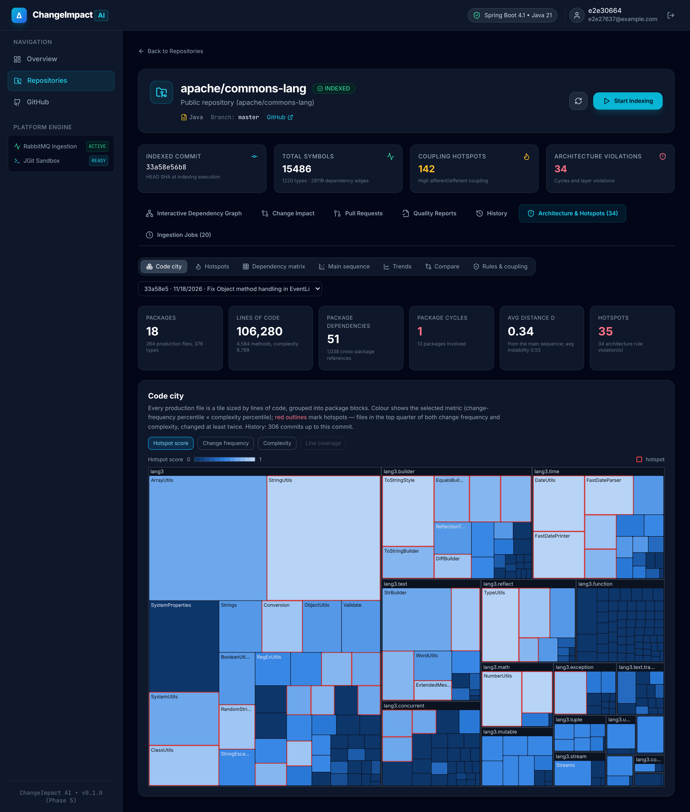
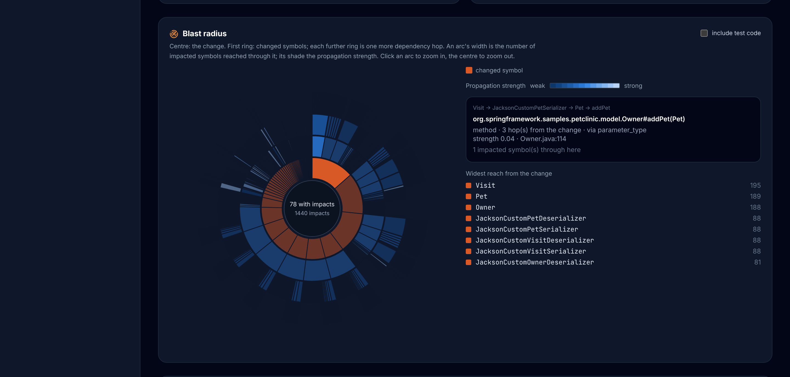
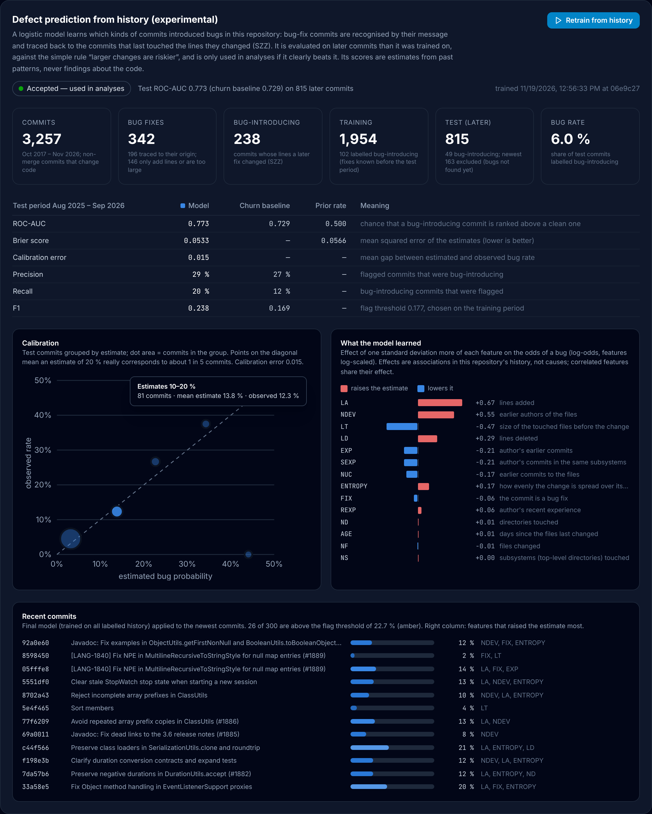
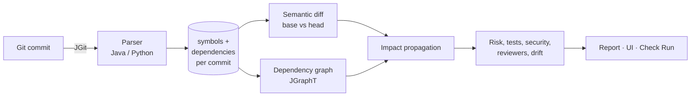

# ChangeImpact AI

**What does this change affect, how risky is it, and what should be checked before it is merged?**

ChangeImpact AI answers these questions from the code itself, for every pull request or pair of commits:

* it parses each commit into symbols and resolved dependencies;
* it compares two commits *semantically* (not line by line);
* it traces every change through the dependency graph to the code and tests it reaches;
* it explains the risk.

Every finding carries its evidence. Repository code is read, never executed.



## What it does

**Change impact analysis.** For two commits, or a pull request, it reports:

* **Semantic changes.** Signature, return type, visibility, inheritance, REST mappings, transactions, security
  annotations and configuration keys. Comment-only edits are ignored. Breaking changes are flagged.
* **Impact.** Every affected symbol with its full dependency path, strength and evidence (verified reference or
  transitive).
* **Risk.** An explainable 0–100 heuristic. Every factor's value, weight and contribution is shown; it is never
  presented as a probability.
* **Pre-merge checklist and suggested reviewers.** Reviewers come from recency-weighted ownership, and the authors
  of the change are excluded.
* **Blast-radius sunburst, analysis timeline,** and Markdown/JSON reports.

**Test intelligence.** Uses the JaCoCo, JUnit, PIT and Dependency-Check reports from your CI:

* the tests that reach the change;
* changed-line coverage;
* mutation quality of the changed methods;
* coverage gaps.

**Security impact:**

* sensitive-code rules;
* Semgrep on changed and impacted files;
* dependency changes joined with known CVEs.

Introduced vulnerabilities are separated from review hints.

**GitHub automation.** A GitHub App analyses pull requests and publishes Check Runs: a summary, the checklist, and
annotations. Webhooks are verified (HMAC, de-duplicated).

**Architecture digital twin.** Per-commit architecture snapshots:

* code city;
* churn × complexity hotspots;
* dependency structure matrix;
* main sequence;
* trends;
* commit-to-commit drift: new cycles, dependencies and rule violations.

**AI review, code search and assistant (optional, Gemini).** A language model explains an analysis for the
reviewer: risks to check, tests to add, questions for the author. It cites numbered evidence from the deterministic
report and code. The platform checks every citation and every code name, and marks each finding *verified* or
*unverified*. The same index powers code search (full-text + vector, measured per query type) and an assistant that
answers questions about a repository from retrieved code, or says the code does not answer them.
[docs/AI_REVIEW.md](docs/AI_REVIEW.md)

**Interactive dependency graph.** Package, class and member views. Focus, isolate a neighbourhood, filter by
relationship. **Centrality** ranks the types that broker dependencies (betweenness) or that everything builds on
(PageRank).

**Architecture rules.** Layered architecture, forbidden dependencies, "only accessed by" and cycle rules, checked on
every analysis. Manage them per repository, preview a rule before saving, and switch global defaults off where they
don't fit. The platform's own design rules are enforced with ArchUnit.

**Code browser.** A read-only Monaco view of any analysed commit. Ctrl/⌘-click or F12 jumps to a declaration
resolved by the analysis; hovers show how each reference was resolved, and a panel lists callers and callees.



**Library-aware resolution.** Dependency jars from the project's Maven or Gradle build are put on the symbol
solver's path. They are read, never executed, and fetched from Maven Central only. Library calls and calls that
pass library-typed arguments then resolve: unresolved references fell from 30,171 to 659 on commons-lang.
[docs/LIBRARY_RESOLUTION.md](docs/LIBRARY_RESOLUTION.md)

**Historical defect model (experimental).** Just-in-time defect prediction trained on the repository's own history
(SZZ labels), with time-ordered evaluation against baselines. It is used only when it beats them
([docs/DEFECT_MODEL.md](docs/DEFECT_MODEL.md)).

**Languages.** All on by default (`ANALYSIS_LANGUAGES=all`), behind a common parser abstraction
([docs/MULTI_LANGUAGE.md](docs/MULTI_LANGUAGE.md)):
* Java (JavaParser with symbol solver and the project's dependency jars);
* Python, JavaScript/TypeScript including React (JSX/TSX), PHP, C#, Go and Ruby (tree-sitter);
* HTML and server-side templates (Thymeleaf, Jinja/Django, Twig), CSS and SQL;
* links across languages: pages to scripts, stylesheets and included templates, `class` attributes and CSS Modules to
  selectors, and JPA entities, Rails models, EF `[Table]` and SQL in strings to the tables the repository's SQL defines.

**Operations:**

* production profile with safety checks;
* rate limiting;
* tenant isolation;
* Prometheus metrics and a Grafana dashboard;
* Docker images;
* backup and restore scripts.

| | |
|---|---|
|  |  |
|  |  |

## Quick start (Docker)

```bash
git clone <this repository> changeimpact && cd changeimpact
./scripts/generate-env.sh http://localhost:8088      # .env with random secrets
docker compose -f docker-compose.full.yml up -d --build
```

Open <http://localhost:8088>, register, connect a public repository (e.g. `spring-projects/spring-petclinic`),
index it, and analyse two commits.

* **Production:** TLS, GitHub App, backups, monitoring and troubleshooting are covered in
  [docs/DEPLOYMENT.md](docs/DEPLOYMENT.md).
* **Configuration:** every setting is listed in [docs/CONFIGURATION.md](docs/CONFIGURATION.md).
* **Demo:** a guided walkthrough is in [docs/DEMO.md](docs/DEMO.md).

## Local development

Requirements: Java 21, Maven 3.9, Node 22, Docker.

```bash
docker compose up -d                          # PostgreSQL (pgvector), RabbitMQ, Redis
```

```bash
cd backend && mvn spring-boot:run             # terminal 1: http://localhost:8080 (dev profile, Flyway V1–V12)
```

```bash
cd frontend && npm ci && npm run dev          # terminal 2: http://localhost:5173
```

Tests: `cd backend && mvn test` (163 tests; Docker required) and `cd frontend && npm run build`. See
[docs/TESTING.md](docs/TESTING.md).

## How it works



Indexing and analyses run as RabbitMQ jobs, with per-repository locking, dead-letter queues and a watchdog. Each
analysed commit is stored once and reused; new commits are analysed incrementally from the closest analysed one.

Details: [ARCHITECTURE.md](ARCHITECTURE.md) (system, modules, sequence diagrams) and
[DATABASE_SCHEMA.md](DATABASE_SCHEMA.md) (ER diagram, migrations).

## Documentation

| Document | Contents |
|---|---|
| [ARCHITECTURE.md](ARCHITECTURE.md) | System overview, backend modules, key flows (sequence diagrams), design rules |
| [API_DOCUMENTATION.md](API_DOCUMENTATION.md) | REST API (`/api/v1`) |
| [DATABASE_SCHEMA.md](DATABASE_SCHEMA.md) | ER diagram and every migration |
| [docs/DEPLOYMENT.md](docs/DEPLOYMENT.md) | Install, TLS, monitoring, backups, upgrades, troubleshooting, acceptance run |
| [docs/CONFIGURATION.md](docs/CONFIGURATION.md) | Every environment variable |
| [SECURITY.md](SECURITY.md) | Threats, controls and their evidence, residual risks |
| [docs/TESTING.md](docs/TESTING.md) | How to run the tests, what they cover |
| [docs/VERIFICATION.md](docs/VERIFICATION.md) | Feature-by-feature verification on the production stack (final run 2026-11-23: 109 API checks, 62 browser checks, operations, image scan) |
| [docs/EVALUATION.md](docs/EVALUATION.md) | How each claim was checked, results, threats to validity |
| [docs/DEFECT_MODEL.md](docs/DEFECT_MODEL.md) | Defect prediction: method, results, limitations |
| [docs/MULTI_LANGUAGE.md](docs/MULTI_LANGUAGE.md) | The analysed languages, their models, cross-language links and limits |
| [docs/LIBRARY_RESOLUTION.md](docs/LIBRARY_RESOLUTION.md) | Dependency jars for type resolution: how, safety, measured effect, limits |
| [docs/AI_REVIEW.md](docs/AI_REVIEW.md) | AI review, code search, assistant: how they work, what is validated, measured results, limits |
| [docs/LIMITATIONS.md](docs/LIMITATIONS.md) | Known limitations, consolidated |
| [docs/DEMO.md](docs/DEMO.md) | Demo script |
| [TECH_STACK.md](TECH_STACK.md) | Versions and compatibility notes |
| [IMPLEMENTATION_NOTES.md](IMPLEMENTATION_NOTES.md) | Setup, verification runs, design decisions per phase |
| [PROJECT_PROGRESS.md](PROJECT_PROGRESS.md) | Phase status and deliverables |

## Status

| Phase | Status |
|---|---|
| 1. Foundation, GitHub ingestion | Done |
| 2. Static code intelligence, dependency graph | Done |
| 3. Change detection, impact analysis, risk | Done |
| 4. AI review, code search (RAG), repository assistant | Done (2026-11-22), optional (Gemini key); evidence-validated, measured in [docs/AI_REVIEW.md](docs/AI_REVIEW.md). The planned multi-agent workflow was replaced by a deterministic pipeline with one model call |
| 5. Test intelligence, security analysis, GitHub automation | Done |
| 6. Production hardening, twin, deployment, defect model, multi-language, documentation | Done (CI pipeline dropped by decision) |

Every analysis result is deterministic: no language model computes changes, dependencies, impacts, tests or risk.
With a Gemini API key, an optional AI review, code search and assistant explain those results; their claims must cite
the evidence and are checked by the platform (verified / unverified). Without a key everything else runs unchanged.
Limitations are listed in [docs/LIMITATIONS.md](docs/LIMITATIONS.md).

## Tech stack

* **Backend:** Java 21, Spring Boot 4.1, Spring Security 7, Spring AI 2.0 (optional), JavaParser 3.28 (patched),
  tree-sitter, JGraphT, JGit, Flyway.
* **Infrastructure:** PostgreSQL 16 + pgvector, RabbitMQ 3.13, Redis 7, Micrometer/Prometheus, OpenTelemetry
  (optional).
* **Frontend:** React 18, Vite 6, TypeScript, Tailwind CSS, TanStack Query, React Flow, Recharts.

Full list: [TECH_STACK.md](TECH_STACK.md).

## License

No license has been chosen yet. Add one before distributing the project.
