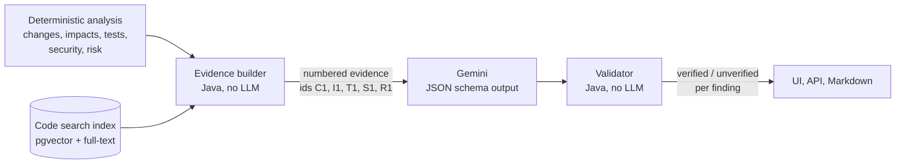
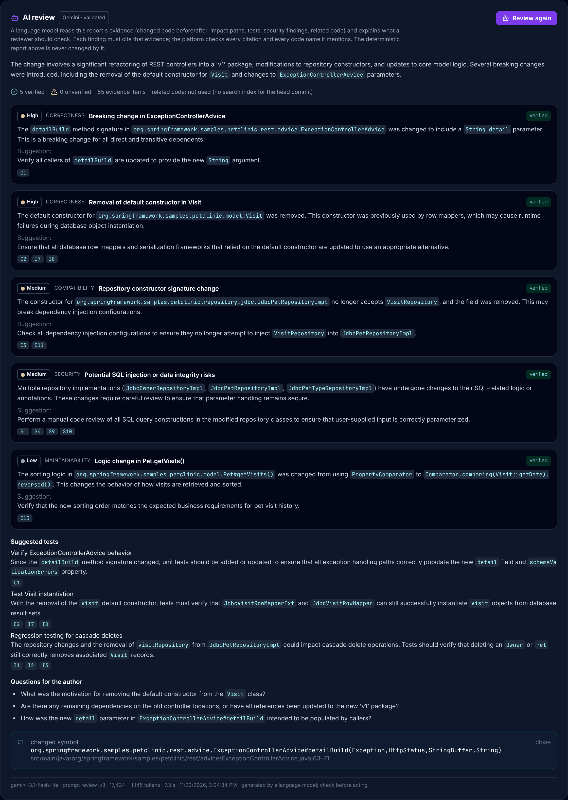

# AI review, code search and assistant (Phase 4)

ChangeImpact AI can add an explanation layer, written by a language model, on top of its deterministic report.
Three features are optional and switched on by a Gemini API key:

* **AI review** of an analysis.
* **AI code search** over a repository.
* **Repository assistant.**

The language model **never decides what changed, what depends on what or how risky a change is.** Those results
come from static analysis and stay unchanged. The model receives that report plus numbered evidence and must cite
the evidence. The platform then checks the answer and marks each claim **verified** or **unverified**.

This document describes:
* how the AI features work;
* what is checked;
* what was measured on real repositories (2026-11-22);
* what is not guaranteed.

## 1. How it works

### Code search index (`RAG_INDEX` job)

* **Chunks.** One chunk per method, constructor and function: the whole body, up to 150 lines. One chunk per type or
  module header: up to 25 lines. Both are cut from the indexed commit using the symbol line ranges found by the
  parser. Secrets are redacted (`SecretRedactor`) before any text leaves the server.
* **Embeddings.** `gemini-embedding-001` at 768 dimensions, unit-normalised. Embeddings are reused across commits
  when the chunk's content hash matches, so re-indexing a new commit only embeds changed code.
* **Full-text.** A PostgreSQL `tsvector`. Words of the symbol's name weigh more than words in its body. Identifiers
  are split at camelCase and punctuation, so `findByLastName` becomes *find by last name*.
* **Retrieval modes:**
  * `fts`: full-text, ranked by `ts_rank` with length normalisation.
  * `vector`: cosine similarity on an HNSW index.
  * `hybrid`: Reciprocal Rank Fusion of both top-50 lists (k = 60).
  * `auto` (the default; the assistant and AI review use it): `hybrid` when the query names code, `vector` for a
    natural-language question. A query names code when it contains `Type#member`, `a.b`, snake_case, lowerCamelCase
    or PascalCase with two or more capitals, or backticks. Section 3 shows why.
* **Fallback.** Without embeddings (no key, or the daily quota is used up), search falls back to full-text and says
  so (`note`).

### AI review (`AI_REVIEW` job)

1. **Evidence.** Java code builds numbered evidence from the completed analysis. It runs under the repository lock,
   at the analysed commits.

   | Id | Evidence | Limit |
   |---|---|---|
   | `C#` | Changed symbols: change types, breaking flag, risk, and before/after source | 15 symbols, 60 lines each |
   | `I#` | Impacted symbols: impact type and depth, verified dependency path, and caller source for direct impacts | 20 symbols, code for 6 callers |
   | `T#` | Test recommendations | 10 |
   | `S#` | Security findings | 10 |
   | `R#` | Related code from the search index (query: the changed symbols' names) | 5 chunks |

   Repository code is wrapped as delimited, untrusted data. The prompt forbids following instructions found in it.
2. **Generation.** Gemini answers with JSON constrained by a response schema:
   * `summary`;
   * `findings[]`, each with severity, category, explanation, suggestion and `citations`;
   * `testSuggestions[]`;
   * `questionsForAuthor[]`.

   Temperature is 0.2. The prompt version (`review-v2`) is stored with every review.
3. **Validation** (`ReviewValidator`, deterministic). A finding is **VERIFIED** only when both hold:
   * it cites at least one evidence id that exists (invented ids are removed and reported);
   * every code name it mentions exists in the evidence text or among the symbols of the analysed commits. This
     covers names in backticks and code-shaped names in plain text (`Type#member`, `a.b(`, lowerCamelCase,
     snake_case).

   Otherwise the finding is kept, marked **UNVERIFIED**, and shown with the reason and the unknown names.

The review is stored with:
* model, tokens and latency;
* the evidence list;
* the validation counts;
* how related code was retrieved.

The UI shows it on the analysis page, where each citation opens its evidence. The Markdown export
(`/analyses/{id}/report.md`) appends it after the deterministic sections, labelled as language-model output.

### Assistant

1. **Retrieval.** A question retrieves the 8 best chunks (`K#`) in `auto` mode, plus verified dependency facts
   (callers and callees from the graph) for the top 4 (`G#`).
2. **Answer.** The model answers in JSON: `answer`, `citations` and `insufficientEvidence`.
3. **Validation.** The same validator gives the answer one status:
   * `VERIFIED`;
   * `UNVERIFIED`;
   * `INSUFFICIENT_EVIDENCE`: the model reported that the code does not answer the question.

   Answers are stored per user and repository.

### Models and failure handling

| Setting | Value |
|---|---|
| Chat model | `GEMINI_CHAT_MODEL` (default `gemini-3.5-flash`) |
| Fallback model | `GEMINI_FALLBACK_MODEL` (default `gemini-3.1-flash-lite`) |
| Retry policy | The chat model gets two attempts; 429, 5xx and timeouts are retried; then the fallback model is tried |
| Model actually used | Stored with every review and answer (Gemini's `modelVersion`) |

**Rate limits.** Gemini's free tier allows 100 embedded texts per minute and 1,000 embedding requests per day. The
platform handles this as follows:
* The client throttles itself to `GEMINI_EMBED_PER_MINUTE`.
* Index builds keep 10 % of that budget free, so searches do not queue behind an index build.
* Query embeddings are cached (512 recent queries).
* A *daily* quota error is not retried: searches fall back to full-text immediately, with a note that says when the
  quota resets.

## 2. What leaves the server

Text is sent only when someone builds a search index, searches in vector mode, requests an AI review, or asks the
assistant. What is sent to Google's Gemini API (`generativelanguage.googleapis.com`):

* code chunks, secret-redacted;
* search queries and questions;
* the review evidence: the deterministic report and the code excerpts listed above.

Nothing is sent when `GEMINI_API_KEY` is empty, and all deterministic features work without it. Gemini's data use
depends on the Google plan (free-tier inputs may be used by Google to improve its products). Use a paid plan, or
leave the key empty, for code that must not be shared on those terms.

## 3. Retrieval evaluation

**Method.**
* **Query sets.** Labelled sets of natural-language questions and identifier lookups, in
  [`docs/verification/ai/`](verification/ai/). Labels were written from the source before any search was run.
* **Hit definition.** A hit is a result whose symbol is one of the query's labelled symbols.
* **Metrics.** Hit@1, Hit@5 and MRR@10 (mean reciprocal rank of the first hit within the top 10).
* **Script.** `retrieval_eval.py`; raw results are in `results/`.

### spring-petclinic @ 500158f (Java, 245 chunks)

25 natural-language questions (e.g. "how are vets cached", "reject a pet birth date in the future") and 20
identifier lookups (e.g. `findByLastNameStartingWith`, `PetTypeFormatter parse`).

| Retriever | Questions Hit@1 | Questions Hit@5 | Questions MRR | Identifiers Hit@1 | Identifiers Hit@5 | Identifiers MRR |
|---|---|---|---|---|---|---|
| Full-text, V13 (unweighted) | 0.24 | 0.56 | 0.372 | 0.15 | 0.50 | 0.336 |
| Full-text, V14 (name-weighted) | 0.16 | 0.56 | 0.337 | **0.75** | **1.00** | 0.854 |
| Vector | **0.72** | **1.00** | **0.830** | 0.95 | 1.00 | 0.975 |
| Hybrid RRF, V13 | 0.44 | 0.76 | 0.570 | 0.40 | 0.85 | 0.571 |
| Hybrid RRF, V14 | 0.48 | 0.84 | 0.633 | **0.95** | **1.00** | **0.975** |
| **auto** (vector for questions, hybrid for names) | **0.72** | **1.00** | **0.830** | **0.95** | **1.00** | **0.975** |

Median latency: full-text 12–16 ms; vector and hybrid 250–275 ms, mostly the query embedding call.

**What the numbers led to:**

1. **Unweighted full-text failed even exact names.** It missed `PetValidator` entirely in its top 10. With OR
   semantics and no name weighting, long chunks that say "pet" many times outrank the class called `PetValidator`.
   Weighting name words above body words (V14) lifted identifier Hit@1 from 0.15 to 0.75, and fixed the hybrid
   ranking for names.
2. **On natural-language questions, fusion hurts.** Full-text matches common words ("owner", "pet", "visit"), and
   with equal RRF weights that noise pushes the right code down. Hybrid reached Hit@5 0.84 where vector reached
   1.00. Hence `auto`: vector for questions, hybrid where exact names help.
3. **Embeddings carry most of the quality.** Vector search alone found a relevant symbol in the top 5 for all 45
   queries.

**Held-out check: psf/requests @ 3c7baaa** (Python, 743 chunks). 25 questions and 15 identifier lookups, written
after the changes above and before any search on this repository. Run 2026-11-23, when the daily embedding quota had
reset; no search fell back to full-text.

| Retriever | Questions Hit@1 | Questions Hit@5 | Questions MRR | Identifiers Hit@1 | Identifiers Hit@5 | Identifiers MRR |
|---|---|---|---|---|---|---|
| Full-text, V14 | 0.12 | 0.48 | 0.258 | 0.53 | 0.87 | 0.683 |
| Vector | **0.92** | **1.00** | **0.960** | 0.80 | **1.00** | 0.863 |
| Hybrid RRF (equal weights) | 0.40 | 0.80 | 0.572 | **0.87** | 0.93 | **0.896** |
| **auto** | **0.92** | **1.00** | **0.960** | **0.87** | 0.93 | **0.896** |
| RRF, full-text weight 0.25 / 0.5 (offline) | 0.68 / 0.52 | 1.00 / 0.96 | 0.823 / 0.713 | 0.80 / 0.87 | 0.93 / 0.93 | 0.878 / 0.908 |

**What the held-out set shows:**
* **Questions.** It confirms the `auto` design: vector search alone beats any fusion with full-text.
* **Identifiers.** Hybrid ranks better (Hit@1 0.87 vs 0.80, MRR 0.90 vs 0.86), but one lookup that vector search
  placed in its top 5 fell out of the hybrid top 5.

`auto` therefore keeps hybrid for code names. Raw results: `results/requests-*-all.json`.

**Threats to validity.**
* The sets are small: 45 queries on petclinic, 40 on requests.
* One person wrote the labels.
* The `auto` rule and the V14 weighting were chosen after seeing the petclinic results; the held-out set confirms
  them for questions and is mixed for identifiers (better ranking, one fewer top-5 hit).

## 4. AI review evaluation

**Method.**
* **Runs.** Six completed analyses (Java and Python, from 9 to 254 changed symbols) were reviewed with prompt
  `review-v2` (`review_eval.py`).
* **Correctness.** Every finding was compared with the actual diff by a person (`git diff base head`), and every
  test or method name it mentions was looked up.
* **Validator verdict.** Each finding's verified/unverified status was recorded as the validator gave it.

### Runs (`review-v3`, `results/ai-reviews-v3.json`)

| Analysis | Changed symbols | Model that answered | Tokens in + out | Model latency | Findings | Validator: verified | Checked against the diff |
|---|---|---|---|---|---|---|---|
| spring-petclinic 818c413→500158f | 12 | gemini-3.1-flash-lite | 9,153 + 871 | 4.6 s | 3 | 3 | 2 correct and specific; 1 speculative ("open redirect": the redirect target is a fixed path) |
| psf/requests 3816cfa→3c7baaa (Python) | 16 | gemini-3.1-flash-lite | 22,810 + 990 | 13.5 s | 3 | 3 | 3 correct (`no_proxy` matching, `has_read` detection, type annotations) |
| commons-lang 69a0011→06e9c27 | 20 | gemini-3.1-flash-lite | 10,627 + 747 | 3.2 s | 3 | 3 | 2 correct; 1 **partly wrong**: the new `IllegalArgumentException` is right, but "callers relied on an empty string" is wrong (the old loop threw `StringIndexOutOfBoundsException`) |
| commons-lang 1af74dd→33a58e5 | 9 | gemini-3.1-flash-lite | 4,088 + 517 | 4.1 s | 1 | 1 | correct, but incomplete: it misses that `Object` methods are no longer forwarded to listeners (the `review-v2` run found this) |
| spring-petclinic-rest fae776d→0515ec8 | 94 | gemini-3.1-flash-lite | 17,424 + 1,145 | 7.3 s | 5 | 5 | 3 correct (`detailBuild` signature, `JdbcPetRepositoryImpl` constructor, `getVisits` sorting); 1 generic (SQL review hint); 1 **partly wrong**: removing `Visit()` does not break row mappers (Java's implicit constructor remains); the real effect is that `date` no longer defaults to today |
| spring-petclinic-rest 72fa510→9545f8c | 254 | gemini-3.1-flash-lite | 11,074 + 998 | 71.1 s | 3 | 3 | 2 correct (Ext interfaces merged; row mapper now runs 3 queries per row instead of 1); 1 generic |

`gemini-3.5-flash` answered 503 (overloaded) throughout this run, so the fallback model wrote all six reviews. On the
same day, `gemini-3.6-flash` wrote one review during the `review-v2` run.

**Totals for `review-v3`.** 18 findings, all verified by the validator:

| Outcome | Findings |
|---|---|
| Correct and specific | 13 (72 %) |
| Generic or speculative (not wrong, little value) | 3 |
| Partly wrong: right change, wrong consequence | 2 |
| Invented code | 0 |

Of 13 test suggestions, 12 were verified. One was flagged only because of a literal (`` `[[` ``): a validator false
positive, fixed afterwards and covered by a test. Reviews cost 4–23k input tokens; model latency was 3–71 s, wall time
10–90 s including retries.

*The fae776d→0515ec8 review in the UI; the C1 citation is open. The second finding ("Removal of default constructor
in Visit") is one of the two partly wrong findings: it is marked verified because its citations and names are real,
but its stated consequence is wrong.*

### What the evaluation changed

| Problem found | Run | Fix |
|---|---|---|
| The validator only checked names in backticks. The first reviews wrote names as plain text, so they went unchecked | `review-v1` | Plain-text, code-shaped names are checked too; the prompt asks for backticks (`review-v2`) |
| An invented method (`EventUtils.bindEvents`; the real one is `bindEventsToMethod`) | `review-v2` | None needed: the validator caught it and marked the finding UNVERIFIED (true positive) |
| "8 REST controllers removed". The model repeated the deterministic report, which lists a class renamed together with its file (`OwnerRestController` → `v1/OwnerRestControllerV1`) as REMOVED + ADDED. The ADDED classes fell outside the evidence limit | `review-v2` | Git's rename list goes into the evidence, plus a note on each "removed" symbol whose file was renamed (`review-v3`). The v3 review of the same analysis no longer makes the claim |
| A literal in backticks was treated as an unknown name | `review-v3` | Literals without identifiers are accepted |
| Two correct findings marked UNVERIFIED: a 125-character method name in backticks exceeded the validator's 120-character span limit. The backticks were then paired wrongly, and prose (", adding") was checked as code | production verification, 2026-11-23 | Spans are paired in order with no length limit; regression test with that exact text. The same review re-run: 3/3 verified |

**What the validator can and cannot do.** It reliably catches invented citations and invented code names (one real
catch in 37 findings across v2 and v3). Its own false alarms are possible (two were found and fixed, see above). It cannot judge reasoning: both partly wrong findings were "verified", because
they cited the right evidence and named only real code. They describe a real change with a wrong consequence. This is
why the UI and the Markdown export label the review as language-model output, and why the deterministic report
remains the source of truth.

**Threats to validity.**
* Six analyses, four repositories.
* One person judged correctness.
* The fallback model wrote most reviews; the primary model was mostly unavailable that day.
* Model output varies between runs. The v2 and v3 runs of the same analyses produced different finding sets (19 vs
  18 findings; one v2 insight missing in v3).

## 5. Assistant evaluation

Four questions about spring-petclinic were asked on 2026-11-22. The answers came from `gemini-3.6-flash`, which is
what `gemini-3.5-flash` was served as that day, using hybrid retrieval (before `auto` existed). The answers were checked against the source.

| Question | Status | Checked against the source |
|---|---|---|
| How does the application find owners by last name, and what happens when none are found? | VERIFIED | Correct: `OwnerController#processFindForm` → `findPaginatedForOwnersLastName` → `OwnerRepository.findByLastNameStartingWith`; when the result is empty it calls `rejectValue("lastName", "notFound", …)` and returns `owners/findOwners` |
| Where is the list of vets cached and what cache is used? | VERIFIED | Correct: `@Cacheable("vets")` on both `VetRepository.findAll` methods; JCache configured in `CacheConfiguration` |
| How is a pet's birth date validated? | VERIFIED | Correct: `@DateTimeFormat` binding, a future-date check in `PetController` create and update, a required check in `PetValidator` |
| How does the application send e-mail reminders for upcoming visits? | INSUFFICIENT_EVIDENCE | Correct: the application has no e-mail feature |

Latency was 10–63 s per answer, and 1,500–2,300 prompt tokens.

## 6. Limits — read before relying on it

* **Verified means grounded, not correct.** The validator proves that a finding cites real evidence and names only
  code that exists. It cannot prove the reasoning. In the evaluation, 2 of 18 verified findings misstated the
  consequence of a real change (section 4). Treat AI findings as review prompts, and the deterministic report as the facts.
* **The model's output varies** between runs and models. The model actually used is stored with each review: when
  `gemini-3.5-flash` was overloaded (503), reviews were written by the fallback `gemini-3.1-flash-lite`.
* **Evidence is bounded.** Changes larger than the limits in section 1 (e.g. 254 changed symbols) are reviewed from
  the highest-risk subset only.
* **The free tier is small.** The quota is 1,000 embedding requests per day; one medium repository index uses most
  of it. Searches then fall back to full-text until the quota resets, and the UI says so.
* **The search index is per commit.** It covers the repository's last indexed commit. An AI review uses related
  code only when the index exists for the analysed head commit.
* **No multi-agent workflow.** `PHASE4_PLAN.md` described six agents. The implementation is a deterministic
  pipeline with one model call per review: the steps that can be computed (dependency investigation, retrieval,
  validation) are Java code, so there is nothing for extra agents to decide. Tool-calling and multi-turn
  conversations are not implemented; each assistant question is answered on its own.
